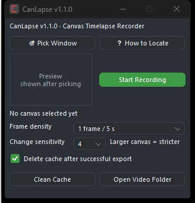
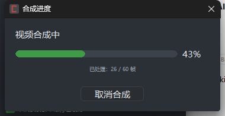

# CanLapse

**Timelapse recorder for drawing-app canvas windows** — Windows 10/11 x64.

Pick a canvas window once, and CanLapse quietly captures it on a schedule, keeps only the frames that
actually changed, and exports a 30 fps MP4 when you stop. Built for digital painters using SAI2,
Photoshop, CLIP STUDIO PAINT or Krita.

`v1.2.1` · single-file executable · no DLLs · English / 中文 UI (follows system language)



---

## Highlights

- **One file, no installation.** `CanLapse.exe` is 3.8 MB and statically links ffmpeg + libopenh264
  and the MSVC runtime. No DLLs, no .NET, no VC++ redistributable. Copy it anywhere and run.
- **Canvas-only capture.** Click the canvas border once; CanLapse records that window, not your desktop.
- **Differential frames.** A frame is saved only when the picture changes — an hour of painting becomes
  a few hundred frames instead of 100k screenshots.
- **Floating control bar.** Dark, rounded, snapped to the top-right corner; drag it left/right along the
  top edge. Pause / mark / stop, with live `00:12 · 3 frames` status.
- **Encoding you can watch (and cancel).** Stopping restores the main window instantly and opens a small
  progress dialog; it closes itself when the MP4 is done.
- **Bilingual UI**, English by default on non-Chinese systems, 中文 on Chinese systems — no language switch.
- **Zero UI framework.** Plain Win32 + GDI, hand-drawn widgets, dark theme.

| Floating bar | Encoding dialog |
|---|---|
|  |  |

---

## Quick start

1. Extract `CanLapse-v1.2.1-win64.zip` to any writable folder (for example `D:\Tools\CanLapse`).
2. Run `CanLapse.exe`.
3. Click **Pick Window** — CanLapse minimizes itself and shows *“Click the canvas border”*.
   Click the canvas (its border or its content; `Esc`/right-click cancels).
4. Choose **Frame density** and **Change sensitivity**, then click **Start Recording**.
5. Work. Use the floating bar to **Pause**, **Mark** (remember this moment) or **Stop**.
6. The MP4 lands in `output\timelapse.mp4` next to the exe. **Open Video Folder** takes you there.

> The first captured frame defines the video resolution. If you resize the canvas mid-session, frames are
> scaled proportionally and letterboxed.

`cache\` (session frames) and `output\` (videos) are created automatically next to the executable, so a
USB-stick copy stays self-contained.

---

## Requirements

| Item | Requirement |
|---|---|
| OS | Windows 10 / 11, 64-bit (x64). ARM64 works through emulation. |
| Desktop composition | DWM must be enabled (default on Windows 10/11). |
| Runtime | **None.** No DLLs, no .NET, no Visual C++ redistributable, no installer. |
| Drawing apps | Any app with a floating canvas window: SAI2, Photoshop, CLIP STUDIO PAINT, Krita… |

---

## How it works

```
canvas HWND ──► DWM thumbnail (DwmRegisterThumbnail + rcSource crop)
                     │
                     ▼
              BGRA frame ──► pixel diff (threshold by changed-pixel ratio)
                     │                 │
             changed │                 │ nearly blank
                     ▼                 ▼
              JPEG q85 frame      PNG frame      → cache\<session>\frame_NNNN.*
                     │
                     ▼
   static ffmpeg 9.0.2 (libavformat + libopenh264)  →  H.264 High, 30 fps, 2 s GOP
                     │
                     ▼
              output\timelapse.mp4
```

- Capture uses the **DWM thumbnail** of the target window, read back through
  `PrintWindow(host, PW_RENDERFULLCONTENT)`, so it works for GPU-composited apps and never steals focus.
- Recording **auto-pauses when another app is in the foreground** (you are not painting) and resumes when
  you return to the canvas.
- Encoding is a hand-written FFI layer over avcodec/avformat; no `ffmpeg.exe`, no subprocess.

---

## Settings

| Setting | Options | Default |
|---|---|---|
| Frame density | 1 frame / 5 s · 1 frame / 2 s · 1 frame / s · 2 frames / s | **1 frame / 5 s** |
| Change sensitivity | 1 = 0.08 · 2 = 0.04 · 3 = 0.02 · **4 = 0.01** · 5 = 0.008 · 6 = 0.004 · 7 = 0.002 · 8 = 0.001 | **4** |
| Playback rate | fixed 30 fps | — |
| Quality | fixed medium (H.264, ~0.06 bpp) | — |
| Auto-clean cache | delete session frames after a successful export | on |

*Frame density* is how often the canvas is checked; *sensitivity* decides whether the change is worth a
frame. Large canvases need higher sensitivity (5–8).

---

## Files and logs

| Path | Content |
|---|---|
| `output\timelapse.mp4` | exported video (fixed name — **a new export overwrites it**) |
| `cache\<timestamp>_<process>\` | JPEG/PNG frames of one session + `markers.json` |
| `canlapse.log` | startup / pick / record / encode diagnostics |
| `crash.log` | only if the app crashed (panic or unhandled exception) |

Both logs live next to the executable; a copy is also written to `%LOCALAPPDATA%\CanLapse\` for support.

Optional environment variables: `CANLAPSE_CACHE` (cache root), `CANLAPSE_LANG=en|zh` (force UI language,
mainly for testing).

---

## Build from source

Prerequisites: Rust (MSVC toolchain), Visual Studio Build Tools with the Windows SDK.
**The static ffmpeg/openh264 libraries are vendored** in `deps/ffmpeg-static/`, so a plain build produces
the same single-file executable — no external SDK required.

```powershell
# debug build + icon/version injection
pwsh -File tools\build.ps1

# release build (what ships)
pwsh -File tools\build.ps1 -Profile release

# assemble dist\CanLapse-v<version>-win64.zip (exe + 使用说明.txt only)
pwsh -File tools\package.ps1 -Version 1.2.1

# tests (34)
cargo test --offline
```

Notes:

- `.cargo/config.toml` sets `-C target-feature=+crt-static`; `build.rs` statically links
  `avformat/avcodec/swscale/swresample/avutil/openh264` plus the Windows system libraries, and finds the
  vendored libs automatically (override with `CANLAPSE_FFMPEG_STATIC`).
- Resource injection (icon + version info) happens **after** linking via `tools\embed-resources.ps1`;
  run the build and the injection script as a pair (that is what `build.ps1` does).
- Rebuilding the static libraries themselves (only needed when bumping ffmpeg/openh264) is documented in
  [`deps/ffmpeg-static/README.md`](deps/ffmpeg-static/README.md).

### Project layout

```
src/                  Rust sources (ui/, capture.rs, recorder.rs, encode/, session.rs, lang.rs, …)
deps/ffmpeg-static/   vendored MSVC static libs + licenses + rebuild notes
tools/                build.ps1, package.ps1, embed-resources.ps1, ResInject.cs, 使用说明.txt
docs/evidence/        screenshots used in this README and in the logs
tests/                integration tests
```

---

## Troubleshooting

| Symptom | Cause / fix |
|---|---|
| Preview shows toolbars and layer panels | The canvas is not a floating window. Click **How to Locate** for per-app steps. |
| “Desktop composition (DWM) is off” | DWM is disabled on this machine/session; thumbnail capture is unavailable. |
| Recorded area is black outside the screen | The DWM thumbnail only contains on-screen pixels; keep the canvas on a visible monitor. |
| No frames at all | The canvas never changed during the recording — the session is discarded with a notice. |
| Video is short | Playback is fixed at 30 fps; `seconds = frames / 30`. Raise frame density for more frames. |

---

## Known limitations

- Canvas picking is manual by design (no auto-detection of “the canvas”).
- Only the on-screen part of a window is captured.
- Session frames are lossy JPEG (q85); re-exporting decodes once, without compounding loss.
- Encoding is single-threaded: roughly 8–9 frames/s at 982×812 on a typical desktop CPU
  (hardware encoders are on the v1.3 list).
- Output filename is fixed (`timelapse.mp4`); rename or move the file to keep several exports.
- The floating bar position is not persisted (it snaps back to the top-right each session).

---

## Documentation

- [CHANGELOG.md](CHANGELOG.md) — version history (English + Chinese).
- [完工日志.md](完工日志.md) — Chinese completion/seal log: deliverables, verification matrix, build
  archaeology, per-version supplements (v1.1 i18n, v1.2 single-file).
- [项目总结.md](项目总结.md) — Chinese design notes: architecture, measured numbers, pitfalls.
- [使用说明.txt](tools/使用说明.txt) — bilingual end-user guide shipped in the zip.

---

## License

- **CanLapse source code**: MIT — see [LICENSE](LICENSE).
- **ffmpeg 9.0.2**: LGPL-2.1-or-later, statically linked (no GPL components enabled) —
  see [THIRD-PARTY-NOTICES.md](THIRD-PARTY-NOTICES.md).
- **OpenH264 2.6.0**: BSD-2-Clause, statically linked — see [THIRD-PARTY-NOTICES.md](THIRD-PARTY-NOTICES.md).

The release executable embeds LGPL-licensed ffmpeg code. If you redistribute the binary, keep this README
and the notices with it, and note that relinking against a modified ffmpeg is possible by following the
build instructions above.
